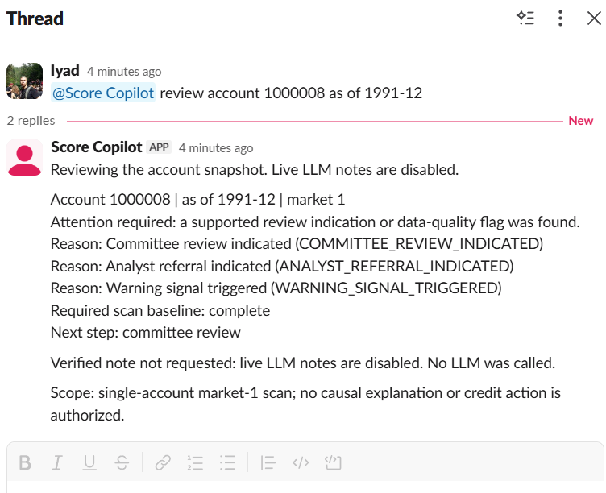

# Slack Customer Score Copilot

A portfolio and learning project combining constrained SQLite tools, policy
retrieval, provider-neutral tool calling and independently checked explanations.
The Slack interface provides single-account reviews over a fictional dataset.
All demonstration data and policies are independently invented for this project.

The default dataset contains **72 accounts and 1,380 monthly observations** in
three fictional markets. Dates are generated directly from 1990–1991. Scores use
an independently chosen 0–449 scale; bins are `1 + score // 50`.

## Offline setup on Windows

Run from the project root in PowerShell using Python 3.11 or 3.12.

```powershell
py -3.11 -m venv .venv
$py = ".\.venv\Scripts\python.exe"
$env:POLICY_VERSION = "v1.0"
& $py -m pip install -r requirements-dev.txt
& $py -m pip check
& $py -m src.data_loader
& $py -m pytest -q -rs
```

The pinned regression environment includes the optional provider/Slack SDKs,
but these commands make no provider or Slack calls. Package installation uses
the network. No API credentials or NLTK corpus downloads are required.

The setup validates the committed CSV and both sidecars by exact regeneration,
then builds `data/scores.db`. Altered or partially missing inputs fail setup.
If all three inputs are absent, the default independent generator creates them.
The original project's files and database are never copied or modified.

On Linux, create a Python 3.11/3.12 venv, select its Python, export
`POLICY_VERSION=v1.0`, then run the same pip/data-loader/pytest modules.

## Offline walkthrough

```powershell
New-Item -ItemType Directory -Force generated | Out-Null
& $py -m scripts.scan_batch_712 --accounts 1000008 --as-of 1991-12-01 --output generated\scan.json
& $py -m scripts.demo_benchmark_62 --output generated\scripted_v2.json
& $py -m scripts.score_benchmark_63 --input generated\scripted_v2.json --output generated\scores_v2.json
```

Expect the scan to complete with a committee-review indication for the planted
severe drop. Expect **six benchmark passes**: five publications and CF-004's
correct insufficient-evidence block. Reports use exclusive new filenames.
Choose new names when repeating the walkthrough.

The scanner uses the real generated database. The benchmark uses separate,
independently authored v2 histories and scripted provider responses; it does not
measure live-model accuracy or TF-IDF ranking. Module numbers in older Python
filenames identify implementation stages, not the new fixture/data identity.

The existing real agent, numerical/policy validators, temporal checks,
deterministic composers and publication gates remain in the path. An untrusted
provider draft is never automatically published. Policy signals are distinct
from administrative warning status and credit decisions.

## Larger data

```powershell
& $py -m src.synthetic_dataset --profile large --output-dir generated\large
```

The large profile creates **3,000 accounts / 131,868 rows**, with fictional
1987–1991 histories in established markets and a 12-month new market. Seed,
account count and calendar are configurable; see `--help`. Output directories
must be new. Increasing account count preserves existing accounts for the same
seed/calendar. Deliberate coverage omissions explain the actual row counts.

The scanner remains limited to market 1 and at most 25 accounts per request.
Larger scanning workloads must be split into bounded batches. Other markets
remain usable through score tools and explicitly scoped policy evaluation.

## Learn the design

- [Data provenance and numerical rules](docs/DATA_PROVENANCE.md)
- [Architecture and test boundaries](docs/ARCHITECTURE.md)
- [Migration review and exclusions](docs/MIGRATION_REVIEW.md)
- [Validation evidence](docs/VALIDATION.md)
- [Experimental policies](experiments/policies/README.md)

Live adapters and the Slack interface are retained, including request budgets,
pacing, scoped tool dispatch and fail-closed handling. Live operation is opt-in
and is not required for this walkthrough or the migration checks.

## Slack interface

With an existing Slack app configured for Socket Mode and app mentions, set
`SLACK_BOT_TOKEN`, `SLACK_APP_TOKEN` and `SLACK_ALLOWED_CHANNEL_ID` in your local
ignored `.env` file. Use `.env.example` for the variable names; never commit tokens.
Start the listener with:

```powershell
$py = ".\.venv\Scripts\python.exe"
$env:POLICY_VERSION = "v1.0"
& $py -m scripts.run_slack_review_83
```

In the configured channel, mention your bot followed by:

```text
review account 1000008 as of 1991-12
```

The default mode connects to Slack and runs local database scans. It makes no
LLM calls. Optional generated notes require explicit live-provider options and
remain subject to request budgets and the publication gate.
The synthetic Slack round trip was demonstrated on 2026-10-24: account
`1000008`, as of December 1991, produced warning, analyst-referral and
committee-review indications with complete baseline coverage. No LLM was called.



*Actual Slack demonstration using fictional data and a local database scan;
no generated LLM note or automated credit decision.*

See the [demonstration guide](docs/PORTFOLIO_DEMO.md) to reproduce the walkthrough.

## Verification checkpoint

The owner completed local Windows validation and confirmed four successful
hosted CI jobs (Ubuntu/Windows, Python 3.11/3.12) for the fresh root commit
`6586c3e` on 2026-10-24. See [validation evidence](docs/VALIDATION.md) for scope.
This educational demonstration does not establish real-world risk calibration
or authorize credit decisions.

`EXPORT_MANIFEST.json` records the original migration export snapshot, available
at commit `6586c3e`. Subsequent documentation updates do not change that historical
snapshot or its hashes.

## License

Project software and associated documentation are provided under the
[MIT License](LICENSE). Third-party dependencies retain their own licenses.
