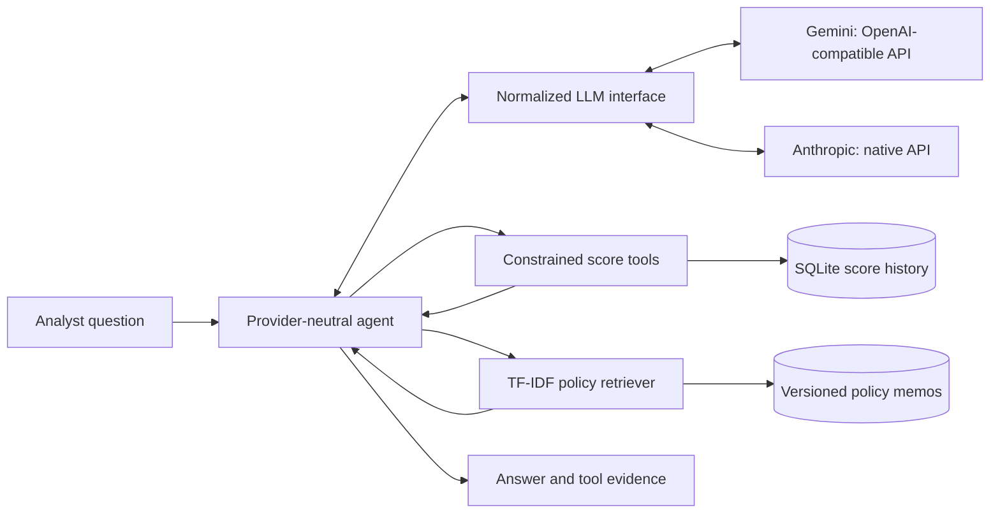

# Behavioral Score Trajectory Copilot

**A provider-neutral AI agent that analyzes behavioral credit-score trajectories using exact database queries and policy-grounded retrieval.**

> **Status — October 2026:** Working research/portfolio prototype with SQLite tools, TF-IDF policy retrieval, multi-round tool calling, and live Gemini and Anthropic adapters. A small exploratory policy-refinement study is documented. Automated answer guardrails, repeatable benchmarks, and a production user interface are **not yet implemented**.

## The problem

A monthly behavioral score might fall, cross a risk band, recover, or fluctuate unexpectedly. Translating that history into an analyst-facing assessment requires **two different evidence sources**:

- **Numerical evidence:** exact scores, dates, bin transitions, and account/market statistics retrieved through constrained SQL-backed tools.
- **Policy evidence:** definitions, early-warning criteria, exceptions, and recommended review actions retrieved from versioned Markdown memos.

The copilot uses a tool-calling LLM to request both forms of evidence and construct an explanation. Its aim is to describe **observed changes and their potential policy implications**, not to infer the underlying cause of customer behavior from score history alone.

This project demonstrates AI-assisted credit-risk analysis using sample data and synthetic policy documents. It is a research prototype, not a production system for making lending or underwriting decisions.

## Architecture



**Design rule:** facts from tools; policy context from retrieval; prose from the model. The final step remains fallible: collecting evidence does **not** prove that the model uses it correctly.

### Chronological workflow

The architecture above shows **which components interact**; the sequence diagram below shows **the order in which they interact** during an illustrative agent run. Time flows **from top to bottom**: the agent sends the question to the selected LLM, executes requested score and policy tools, returns the retrieved evidence to the model, and delivers its response. Tool calls can be batched or repeated, so the exact sequence varies by question and model.


For an editable Mermaid version and more detail, see [Architecture](docs/architecture.md).

## What works today

| Layer | Implemented capability |
| --- | --- |
| Data | CSV loading into an indexed SQLite database |
| Score tools | Six predefined account/market query and trend functions; no model-generated SQL |
| Retrieval | Seven policy memos; heading-aware chunks, TF-IDF, Porter stemming, cosine similarity |
| Agent | Combined tool registry, bounded tool loop, Python dispatch, captured tool evidence |
| Provider abstraction | Project-owned `ToolCall` / `LLMResponse`; shared adapter interface |
| Live provider paths | Gemini through an OpenAI-compatible endpoint; Anthropic through its native Messages API |
| Experiment | Four exploratory provider × policy-version runs with archived qualitative observations and execution counts |

**Not yet built:** deterministic policy-rule execution, post-generation numeric/policy claim validation, repeated benchmarking, CI, or a standalone interactive CLI.

## Data and knowledge base

The sample `data/scores_extended.csv` contains **634 monthly records for 33 anonymized accounts across three markets**:

| Market | Accounts | Records | Role |
| --- | ---: | ---: | --- |
| 1 | 15 | 308 | Anonymized base-market sample |
| 2 | 10 | 230 | Synthetic established-market accounts with planted events |
| 3 | 8 | 96 | Synthetic newer-market accounts with shorter, more volatile histories |

The original knowledge base contains seven project-authored memos (`POL-001`–`POL-007`), covering score bins, early-warning thresholds, actions by risk band, market exceptions, data quality, recovery, and escalation. They do **not** represent a lender's actual approved policies.

## Quick start

Run from the repository root (PowerShell example):

```powershell
python -m venv .venv
.\.venv\Scripts\Activate.ps1
python -m pip install -r requirements.txt
python -m src.data_loader
```

Create a local `.env` file, excluded from Git:

```dotenv
GEMINI_API_KEY=your_api_key
# ANTHROPIC_API_KEY=your_api_key
```

Then call the Python entry point:

```powershell
python -c "from src.agent import run_agent; from src.llm_client import get_llm_client; result = run_agent('Why did account 103480 drop bins, and what policy considerations apply?', get_llm_client('gemini'), verbose=False); print(result['answer'])"
```

Change `get_llm_client('gemini')` to `get_llm_client('anthropic')` to use Anthropic. Provider model identifiers, endpoints, and required environment-variable names are defined in `src/config.py`; provider availability and API pricing may change.

`run_agent()` returns `answer`, `completed`, `tool_evidence`, and `tool_rounds`. The default tool-call limit is eight rounds. Current runs may emit adapter debug output. **There is no standalone CLI application yet.**

## Engineering choices

**Hybrid SQL tools + RAG.** Monthly scores are structured, time-indexed facts; free-form semantic retrieval is not a substitute for deterministic database queries. Policy interpretation is a separate document-retrieval concern.

**Provider-neutral orchestration.** `agent.py` works with project-owned response types instead of vendor SDK objects. The two implemented adapters use materially different API conventions, making portability a tested design property rather than an architectural diagram alone. Supporting other providers remains future work.

**Pragmatic provider selection.** Gemini offered an OpenAI-compatible integration path for initial cost-conscious experimentation; the native Anthropic adapter exercised a different tool-use protocol. This project does not declare either provider superior without controlled evaluation.

**Lightweight retrieval baseline.** TF-IDF + stemming is transparent and inexpensive, but semantic mismatches remain (e.g., `recovering` vs. `recovery`). Embeddings are a planned **comparative experiment**, not an assumed fix.

**Treat policy quality as part of RAG engineering.** More complete, unambiguous source documents can improve the evidence available to the model. But document enrichment, retrieval selection, and the model's application of a rule are separate engineering variables.

## Case study — versioned policy refinement

On **10 October 2026**, a preliminary experiment compared the same account question across two providers and two versions of the policy corpus:

- **v1.0:** the seven original demonstration memos.
- **v1.1 (experimental):** POL-002, POL-003, and POL-006 were refined, preserving the original numeric thresholds and the other four memos.

The synthetic project explicitly adopted **manual analyst clearance** for logged early-warning records. Other additions, including the definition of a three-month event look-back and decline-streak counting, remain **provisional interpretations**, not approved real-world credit policy. Neither score recovery nor expiration of a look-back proves a warning was administratively closed; the current tools do not access a warning register.

| Run | Total tool calls | Policy passages returned | Distinct memos retrieved |
| --- | ---: | ---: | ---: |
| Gemini + v1.0 | 5 | 6 | 4 |
| Gemini + v1.1 | 7 | 12 | 5 |
| Claude + v1.0 | 9 | 20 | 7 |
| Claude + v1.1 | 10 | 30 | 7 |

All four runs completed with nonempty answers. In the archived comparison, the **Claude v1.1 output** correctly separated an event inside the February–April 2025 look-back, a decline streak that had ended in April, and an **unverifiable administrative warning status**. The **Gemini v1.1 output** did not retrieve the dedicated passages establishing those distinctions. The comparison also identified unsupported-action risks, missing data-quality retrieval, and temporal-reasoning errors.

**Do not read this table as a performance ranking:** it represents **one run per condition**, without controlled model revisions or complete per-run latency, usage, and cost records. A larger count of retrieved passages does not by itself indicate greater relevance or answer correctness.

See [evaluation notes](docs/evaluation.md) for methodology, observed failures, the decision/assumption boundary, and the next evaluation protocol. Detailed experimental artifacts remain local until selected for publication.

## Reliability roadmap

1. **Claim-level guardrails:** check numbers against the correct tool fields and time windows; flag unsupported policy actions, not just unseen numerical values.
2. **Deterministic temporal checks:** distinguish historical warning events, current trigger conditions, and administrative warning status.
3. **Formal evaluation:** fixed test cases, repeated runs, retrieval relevance, correctness, tool usage, latency, tokens, cost, and failure rates.
4. **Retrieval experiments:** compare TF-IDF with semantic retrieval against the same frozen questions and policy versions.
5. **Publication quality:** curated tests, CI, pinned dependencies, diagrams, sanitized example traces, and clean debug output.

The target evaluation separates three questions: **Was the right evidence retrieved? Was the rule applied correctly? Was the recommendation justified?**

## Repository guide

```text
src/
  agent.py              # Provider-neutral tool orchestration
  llm_client.py         # Provider adapters and normalized responses
  config.py             # Provider/model configuration
  data_loader.py        # CSV -> SQLite
  score_tools.py        # Safe numerical tools
  retriever.py          # Policy retrieval and corpus selection
policy_memos/           # Baseline synthetic policies (v1.0)
data/scores_extended.csv
requirements.txt
docs/evaluation.md      # Curated experimental findings (Phase 2)
```

Experimental `results/` and `module_4_10_v1_1_experiment/` files are not yet part of the public repository and should be reviewed before staging. The evaluation document summarizes their findings without requiring publication of every raw trace.

## Responsible use

A research and portfolio prototype, **not a production credit-decision service**. Score histories do not establish behavioral causality, policy examples are synthetic, and consequential decisions require authorized human review and institution-specific governance. Real deployment would require stronger privacy, security, access-control, monitoring, audit, and validation measures.

**Technology:** Python · SQLite · pandas · scikit-learn · NLTK · TF-IDF RAG · tool/function calling · Gemini · Anthropic · OpenAI-compatible API patterns
