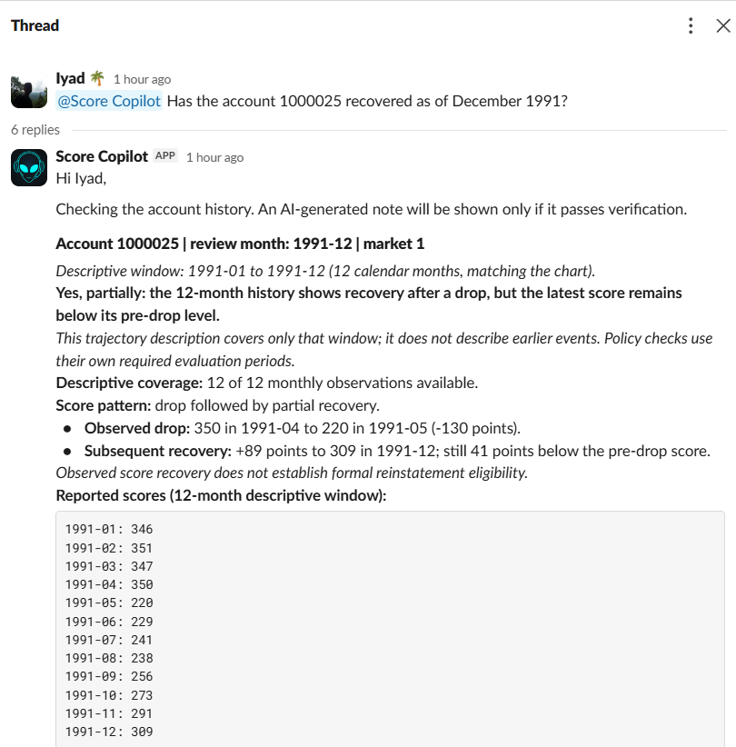
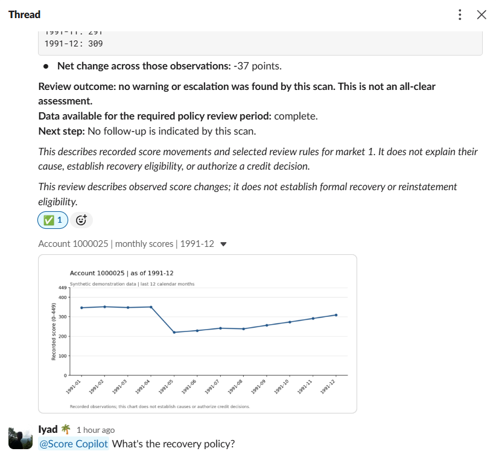
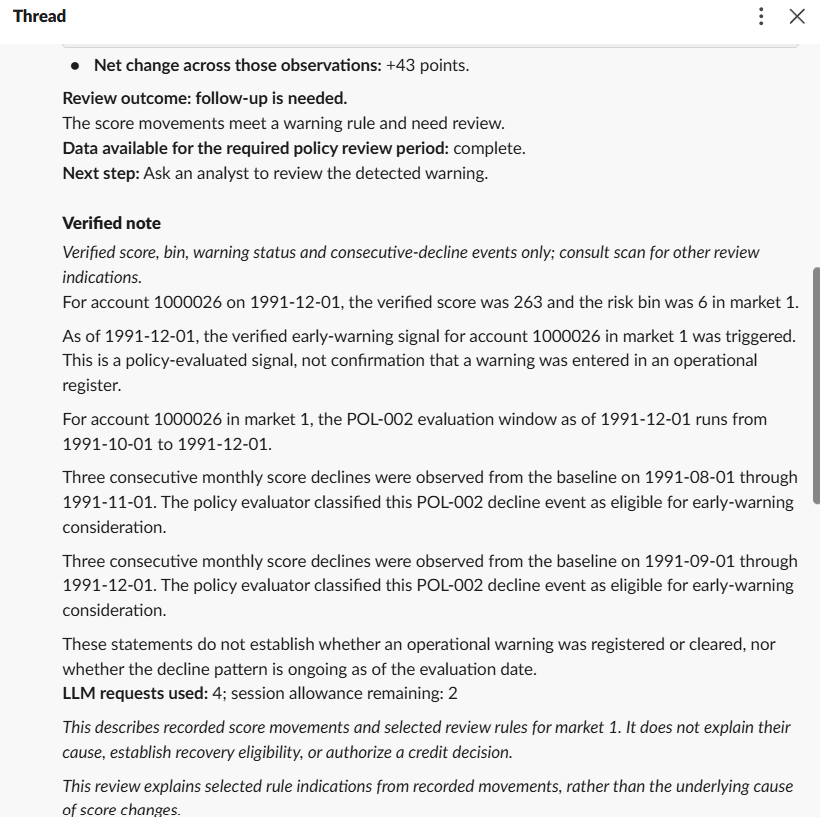
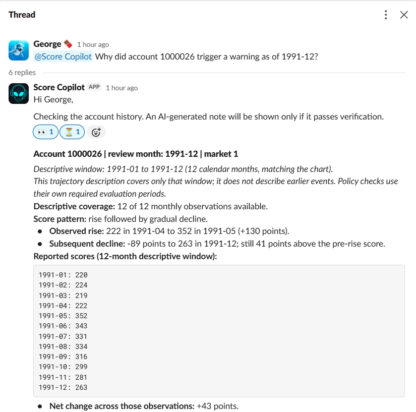
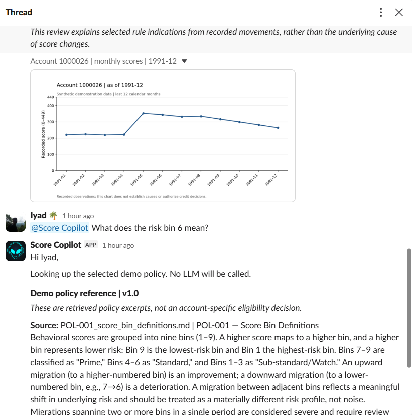
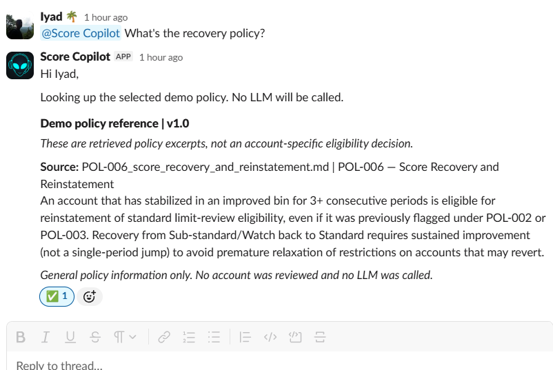
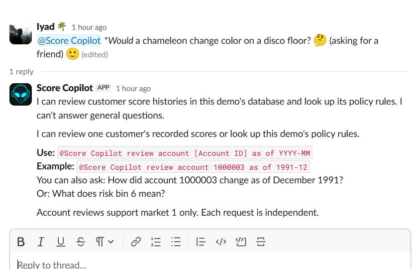

# Customer Score Copilot

**Ask about a customer's score history in Slack. Get a readable review, a twelve-month chart and, when enabled, an LLM-assisted note whose claims must pass independent verification.**

Customer Score Copilot brings constrained database tools and policy retrieval into a familiar chat interface. Ask whether an account has recovered, why a warning rule triggered, or what a risk bin means. The bot returns recorded movements, supporting evidence and a scoped next step, directly in the request thread.

**Live LLM-assisted review with verified claims and a score chart, using synthetic data.**

**Note:** This is a portfolio and learning project built entirely on independently generated synthetic data. All accounts, score histories and demonstration scenarios are fictional; no real customer records or proprietary datasets are used. The policy rules are also independently invented for this demonstration. The project illustrates evidence-based review workflows; it is not a production credit-decision system.

## See it in Slack

### A sharp drop followed by partial recovery

“Has account 1000025 recovered as of December 1991?” receives a direct **“Yes, partially”**: the score fell from 350 to 220, then recovered to 309. The rebound is visible, but the latest score remains below its pre-drop level. Observed recovery is kept separate from formal reinstatement eligibility.





### An earlier rise does not rule out a later warning

For account `1000026`, the twelve-month history shows a sharp rise followed by gradual decline. The selected policy checks identify a current warning even though the December score is above January's. A published **Verified note** supports selected claims about the score, bin and consecutive-decline events.



<details>
<summary>See the warning trajectory, chart and policy answers</summary>







</details>

### Helpful boundaries

An unrelated question gets a scope explanation and examples, rather than an improvised answer. Missing parameters receive clarification; unknown accounts are distinguished from missing observations.



These captures show actual Slack interactions using the optional **showcase** dataset. They are demonstrations, not a general evaluation of model accuracy. The recovery capture shows a local review; the warning capture explicitly includes a published verified note. General policy lookups make no LLM calls, even when live notes are enabled.

## What it does

- **Common English requests:** supports account-review paraphrases and English month names alongside the exact command.
- **Twelve-month context:** descriptive analysis and charts cover the same twelve calendar months ending at the assessment month. Earlier events are outside that description, and later observations are excluded.
- **Distinct policy evaluation:** current warning and escalation checks retain their own defined periods. A historical drop is not automatically a current warning; improvement is not an administrative clearance.
- **Attributed policy answers:** retrieves exact excerpts from the selected demo policy corpus, with source and version.
- **Optional live notes:** eligible reviews can use Gemini or Anthropic through provider-neutral adapters; publication remains conditional on verification.
- **Readable Slack replies:** personalized acknowledgements, headings, bold conclusions, movement bullets and one monthly observation per line. Names are sanitized, briefly cached and kept out of LLM prompts and account evidence.
- **Controlled operation:** allowed-channel restriction, event deduplication, thread routing, constrained tools, request caps and pacing. Chart failures preserve the completed text review without repeating scans or LLM calls. `--no-charts` selects text-only replies.

Requests remain independent: this version has no conversational thread memory, arbitrary account comparisons, forecasting or general-purpose chat. Natural-language interpretation is bounded and deterministic, rather than an LLM intent classifier. Slack account reviews currently support **market 1**.

## How verification works

The local scan establishes the account evidence and policy indications. In live mode, an eligible review can then request a structured set of proposed claims from the LLM.

1. **Retrieve and constrain:** database tools expose bounded score evidence; policy retrieval selects the configured corpus. Baseline `v1.0` and experimental `v1.1` remain separate.
2. **Claim first:** the model proposes structured claims instead of a publishable free-form narrative. This avoids writing prose and then trying to extract the facts the model originally obtained from tools.
3. **Check independently:** schema, numerical, context, policy and temporal checks assess supported claims. The LLM cannot cancel, weaken or override these checks.
4. **Compose deterministically:** public wording is constructed from accepted claims. A failed gate prevents publication of the proposed note; the completed local review can remain available.

Retrieval-augmented generation (RAG) supplies relevant evidence, but **RAG alone does not guarantee factual answers**. The independent checks and publication gate are deliberate safeguards in this implementation. They make unsupported model output blockable rather than trusting fluency as evidence. A “Verified note” covers its explicitly stated claim scope; it is not a guarantee about every possible risk or interpretation.

### Negative tests are part of the result

A **negative test** deliberately supplies an invalid, unsupported or insufficient-evidence case and checks that the system rejects it or withholds publication. Tests cover fabricated numerical claims, untrusted narrative, temporal leakage, unsupported requests and publication failures, alongside successful paths.

The scripted benchmark has six expected passes: five supported publications and **CF-004's correct insufficient-evidence block**. A blocked answer is a successful outcome when evidence is inadequate. These fixtures test system behavior; they do not measure live-model accuracy or real-world risk calibration.

## Set up locally

Use Python **3.11 or 3.12**. From a fresh checkout on Windows, run in PowerShell:

```powershell
git clone https://github.com/IyadKhuder/customer-score-copilot.git
Set-Location customer-score-copilot
py -3.11 -m venv .venv
$py = '.\.venv\Scripts\python.exe'
$env:POLICY_VERSION = 'v1.0'
& $py -m pip install -r requirements-dev.txt
& $py -m pip check
& $py -m src.data_loader
& $py -m pytest -q -rs
```

The loader verifies the committed CSV and its two sidecars by exact regeneration before building `data/scores.db`. Altered or partially missing inputs fail setup; if all three inputs are absent, the default generator creates them. No API credentials or NLTK corpus downloads are needed. Installation uses the network; loading and regression tests make no live Slack or provider requests.

**Existing showcase users:** the data-loader command rebuilds the default database. Do not rerun it merely to update documentation or retain an already selected showcase database.

On Linux, create a Python 3.11/3.12 virtual environment, select its Python and export `POLICY_VERSION=v1.0`; then run the same pip, loader and pytest modules.

### Choose a reproducible dataset

| Profile | Accounts | Observations | Purpose |
| --- | ---: | ---: | --- |
| Default small | 72 | 1,380 | Core scenarios and offline walkthrough |
| Optional showcase | 78 | 1,500 | Adds the two contrasting trajectories shown above |
| Optional large | 3,000 | 131,868 | Larger synthetic histories and bounded batch experiments |

Dates are independently generated; the default and showcase calendars span 1990–1991. Scores range from **0 to 449**, with bin `1 + score // 50`. Deliberate omissions exercise missing-evidence behavior. These are invented scales and rules, not a calibrated financial model.

To reproduce accounts `1000025` and `1000026`, follow [the showcase guide](docs/SHOWCASE_TRAJECTORIES.md), including verification and stopping the listener before selecting its generated database. These IDs are absent from the default small dataset.

For the large profile:

```powershell
& $py -m src.synthetic_dataset --profile large --output-dir generated\large
```

Output directories must be new. See `--help` for seed and calendar options. The scanner remains limited to market 1 and at most 25 accounts per batch; other markets are available through explicitly scoped lower-level tools and policy evaluation.

## Run in Slack

Configure a Slack app for **Socket Mode** and `app_mention` events. Its bot scopes are `app_mentions:read`, `chat:write`, `files:write` and `users:read`; `users:read.email` is unnecessary. Invite the bot to the configured channel. Put `SLACK_BOT_TOKEN`, `SLACK_APP_TOKEN` and `SLACK_ALLOWED_CHANNEL_ID` in the local ignored `.env`, following [.env.example](.env.example). Never commit credentials.

### Local scans, no LLM calls

```powershell
$py = '.\.venv\Scripts\python.exe'
$env:POLICY_VERSION = 'v1.0'
& $py -m scripts.run_slack_review_83
```

This connects to Slack over the internet while scanning the local database. Keep the listener running and mention the installed bot in the allowed channel:

```text
@Score Copilot review account 1000003 as of 1991-12
@Score Copilot How did account 1000003 change as of December 1991?
@Score Copilot What does risk bin 6 mean?
@Score Copilot What is the recovery policy?
```

With the showcase database selected, also try:

```text
@Score Copilot Has account 1000025 recovered as of December 1991?
@Score Copilot Why did account 1000026 trigger a warning as of 1991-12?
```

The assessment month is the cutoff, not permission to use later data. “Why” explains selected rule indications, not the underlying cause of score changes. The chart uses a fixed 0–449 scale and leaves gaps for missing observations.

### Opt in to live LLM notes

Stop the listener with **Ctrl+C** before switching modes. Configure `GEMINI_API_KEY` locally, then run:

```powershell
& $py -m scripts.run_slack_review_83 --confirm-live --provider gemini --daily-remaining 8 --max-requests 8 --per-review-max-requests 8 --interval-seconds 5
```

Anthropic is also supported: use `--provider anthropic` and `ANTHROPIC_API_KEY`. Provider/model availability depends on your configuration and quota; live calls may incur charges.

Only eligible `attention_required` reviews proceed to a live note, with allowance available. Policy lookups and rejected requests make no provider calls. Enabling live mode does not guarantee a note will be generated or published.

`--daily-remaining` is a **user-declared allowance**, not a provider-quota lookup. Session and per-review caps limit request counts, not spending or token costs. A review may take multiple requests; restarting does not restore provider quota. See [mode and request-control details](docs/SLACK_BOT_MODES.md).

## Run the offline walkthrough

```powershell
New-Item -ItemType Directory -Force generated | Out-Null
& $py -m scripts.scan_batch_712 --accounts 1000008 --as-of 1991-12-01 --output generated\scan.json
& $py -m scripts.demo_benchmark_62 --output generated\scripted_v2.json
& $py -m scripts.score_benchmark_63 --input generated\scripted_v2.json --output generated\scores_v2.json
```

Expect a committee-review indication for the planted severe drop and six scripted benchmark passes, including the correct negative-test block. Report filenames must be new on repeated runs. The scanner uses the generated database; the benchmark uses separate authored histories and scripted responses. Historical module numbers identify implementation stages.

## Validation and deployment scope

The owner confirmed a clean working tree and successful hosted CI for checkpoint **`2f23a2e`** on 2026-10-28. The CI matrix covers Windows/Linux and Python 3.11/3.12. Offline regression tests use fake Slack/provider clients; actual Slack captures provide separate integration demonstrations.

The app currently runs through a **local listener**, including demonstrated access by another workspace member. It is not an always-on deployment. A server could host the listener, but production use would require operational work such as secret management, process supervision, monitoring, durable event handling and a review of authorization and data governance.

Recorded movements and selected demo-policy indications do not explain causes, establish formal reinstatement, confirm operational warning registration or clearance, or authorize credit decisions.

## Explore the implementation

- [Architecture and test boundaries](docs/ARCHITECTURE.md)
- [Natural-language requests and policy retrieval](docs/SLACK_CONVERSATION.md)
- [Twelve-month descriptive analysis](docs/DESCRIPTIVE_WINDOW.md)
- [Recovery answers](docs/RECOVERY_ANSWER_PRESENTATION.md)
- [Chart transport and failure handling](docs/SLACK_SCORE_CHARTS.md)
- [Slack rich-text presentation](docs/SLACK_PRESENTATION.md)
- [Data provenance and numerical rules](docs/DATA_PROVENANCE.md)
- [Validation evidence and historical scope](docs/VALIDATION.md)
- [Experimental policies](experiments/policies/README.md)
- [Original migration review](docs/MIGRATION_REVIEW.md)

`EXPORT_MANIFEST.json` records the original migration export at commit `6586c3e`; later changes do not update that historical snapshot or its hashes.

## License

Software and associated documentation are provided under the [MIT License](LICENSE). Third-party dependencies retain their own licenses.
