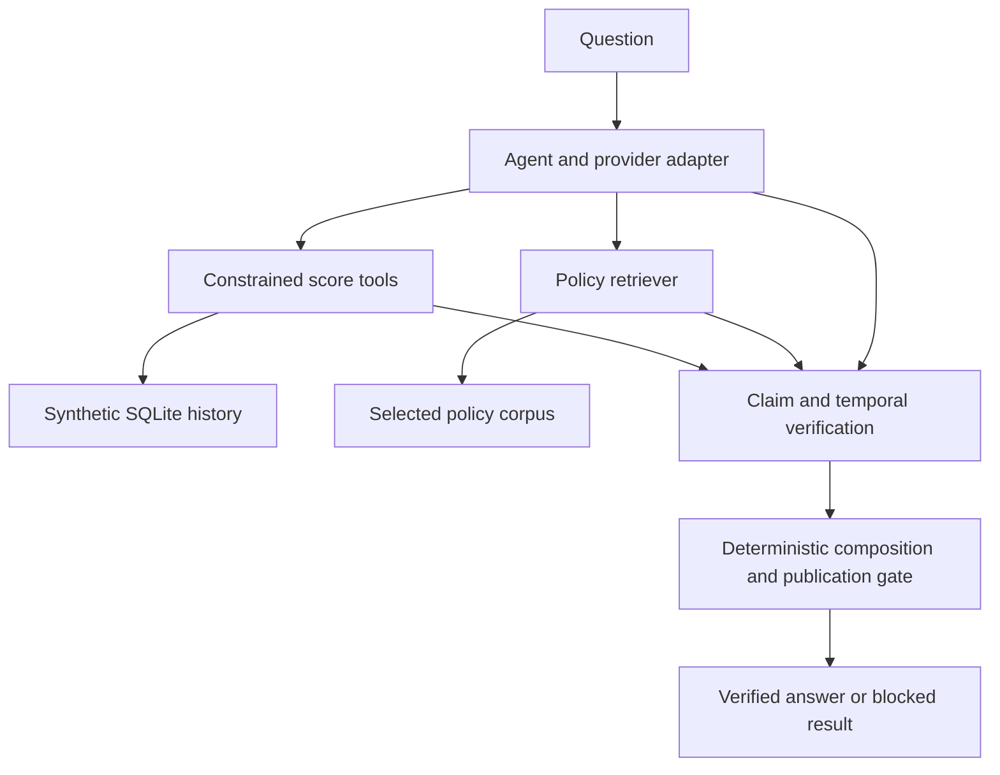

# Architecture and evidence boundaries

The application separates exact observations from policy interpretation and
public prose. Constrained Python tools query SQLite; TF-IDF retrieves policy
passages; provider adapters propose structured claims. Deterministic checks and
composers control publication.

The database has the existing five-column score schema and account-period key.
Generation and verified loading are offline and separate from provider calls.
The primary setup validates its input bundle before rebuilding the candidate's
database. There is no automatic source-data import.

All current publication gates, context/numeric checks, temporal continuity
checks, policy applicability checks, composition restrictions and provider
request controls are retained. The scanner still supports market 1 only,
1–25 accounts per request. Site aggregates and reinstatement are not new
supported scanner decisions.

The ordinary scripted benchmark runs the real agent/verifiers/composers with
fixed history/retrieval tool backends. It records new v2 fingerprints and
gate outcomes, not model capability. The separate `validation/` safety replay
also disables network/SQLite calls and supplies only the actual retriever
schema literal at import time. Neither fixture mode evaluates TF-IDF ranking.
Normal application retrieval still loads the real retriever and selected
policy corpus.

The full regression suite includes real numerical guards, fake-provider
transport tests, request-budget/pacing tests, bounded scan and Slack-service
tests, isolated component fixtures and required generated-database checks.
Scripted providers and fake SDKs do not connect to external services.
