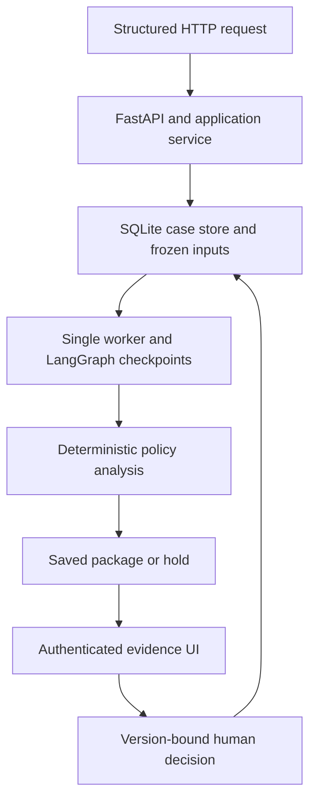

# Case-review application

14 November 2026. Working description; a separate project name is not yet chosen.
Source reviewed at `0615844`, branch `phase2/persistent-review-workflow`.

## Purpose

An analyst reviews one synthetic account at an assessment month, inspects the saved
trajectory, policy evidence and limitations, and approves or rejects the exact
package. Requests are structured, not natural-language prompts. The application is
independently usable from the related Slack/RAG copilot. Physical repository
separation follows M4.2 acceptance; no separation is performed by this patch.

All accounts, histories and policies are invented. This is a portfolio and learning
demonstration, not a calibrated credit model or a production lending system.

## Architecture



| Source | Responsibility |
| --- | --- |
| `src/api.py` | Bearer authentication, bounded inputs, HTTP routes and safe errors |
| `src/case_application.py` | Snapshot capture, durable idempotency, worker, safe projections |
| `src/review_workflow.py` | Case storage, package integrity, atomic decision checks |
| `src/review_graph.py` | Durable orchestration, review pause and checkpoint-gap recovery |
| `src/batch_scan.py` | Deterministic analysis of captured synthetic score rows |
| `src/operations.py`, `src/measured_application.py` | Operational summary and bounded timing observations |
| `frontend/src/` | TypeScript queue, evidence, decisions and operations view |
| `deploy/azure/` | Owner-run on-demand delivery, identity checks and recovery tools |

The seven captured policy texts establish provenance. Compiled deterministic rules
perform evaluation; policy text is not dynamically executed or retrieved by an LLM
in this runtime. The source score DB is separate from the writable case/checkpoint
DB. Cases retain frozen inputs and a package hash. Review sends the displayed
revision and hash; stale, duplicate or conflicting decisions fail rather than
silently replacing a saved decision. Approval does not rerun analysis.

Workflow status, verification status and analyst decision are separate. Here
`passed` means deterministic package completion, not verified LLM prose or complete
evidence. `held/incomplete` can be the correct outcome for missing data. No live
note, autonomous investigation, external notification or Slack bridge is implemented.
Earlier retrieval and agent-role experiments measure separate paths.

## Quick start

Use Docker Compose and Python 3.11/3.12 for the existing HTTP demo tools. From a
fresh checkout in PowerShell:

```powershell
git clone --branch phase2/persistent-review-workflow --single-branch https://github.com/IyadKhuder/customer-score-copilot.git
Set-Location customer-score-copilot
```

Then follow [the local demo](Phase2_M4_2_Final_Review_and_Demo.md), beginning with
its token and isolated Compose setup. Docker builds the frontend and verifies/builds
the default synthetic score DB inside the image; Node and a host data-loader run
are unnecessary for this Docker path. Dependency/image installation needs internet;
case processing makes no Slack/provider requests. The browser opens at
`http://127.0.0.1:8000/`. All case reads, decisions and operations require the token;
the UI shell and health endpoints do not grant case access. Enter the token at
runtime; it remains in page memory and clears on disconnect/reload.

For source development use the [M3.2 build guide](Phase2_M3_2_Case_Queue_and_Evidence.md)
and [API guide](Phase2_M3_1_API_and_Docker.md). Existing users must not rebuild a
selected host score DB merely to apply documentation. The Docker demo's default
source data and writable volume are distinct from that host DB.

## Limits and recovery

- One account, market 1, baseline policies v1.0, first day of an assessment month;
  at most 1,200 captured observations. Missing assessment-month data is held.
- One process/worker and local SQLite lease; no multi-replica, HA, throughput or
  production-scale guarantee. One shared token maps to one demo analyst; no per-user
  login or role separation. Local Compose binds only to loopback.
- Decisions accept/reject the package, not lending, reinstatement or warning
  registration/clearance. A descriptive movement does not establish its cause.
- Frozen historical packages survive source-data changes. Implementation changes
  can block old-case decisions; do not edit hashes or reset held work to bypass this.
- Interrupted running analysis without a saved result is held, not blindly replayed.
  Completed results and decisions recover from saved state. Backups are manual.
- Lifecycle history persists; request/stage samples reset on process restart and
  share a 10,000-observation ring. Provider usage and monetary cost are unavailable.
  Operational aggregation is not a package-integrity audit.
- The isolated benchmark measures two defined in-process HTTP/worker paths. It is
  neither live-model quality evaluation nor hosted network/concurrency testing.

See [M4.1 measurement definitions](Phase2_M4_1_Operations_and_Benchmark.md),
[M3.5 delivery/recovery](Phase2_M3_5_Delivery_and_Recovery.md) and
[owner-observed hosted verification](Phase2_M3_5_Verification_2026-11-14.md).
Azure remains deallocated with no public IP and guard disarmed. The recorded rollback
release intentionally remains selected. Local closure requires no Azure session or
redeployment. Preserve databases, volumes, images, backups and activation receipts.
