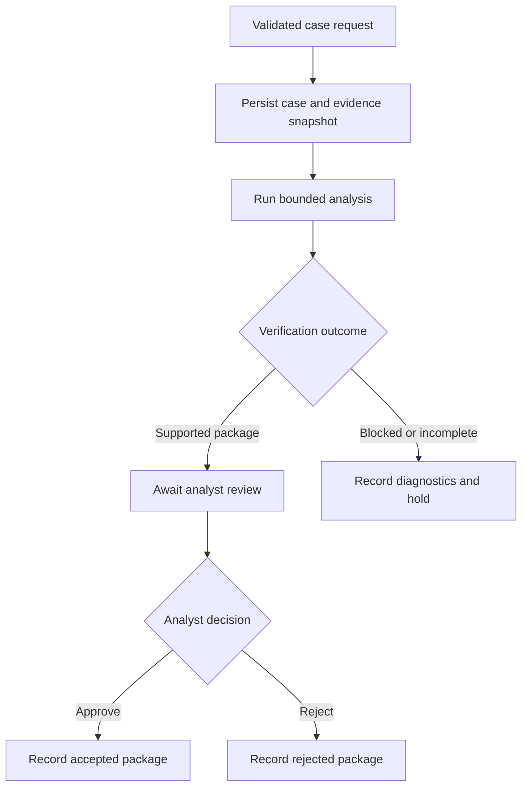

# Customer Score Copilot — Phase 2 blueprint

Date: 30 October 2026
Version: 0.1 — proposed implementation plan
Starting commit: `a4b39ae6c0efbb993b46301e1c905684ff1a74ab`
Repository: https://github.com/IyadKhuder/customer-score-copilot

## Purpose and working agreement

Extend the completed Slack copilot into a persistent analyst-review application with measured retrieval, a polished web interface, a hosted service, and operational visibility. Preserve the existing synthetic-data and claim-verification foundations. The project remains a learning exercise and a portfolio demonstration, with small steps that the owner can explain and reproduce.

The owner confirmed a clean local working tree, matching local and remote commit, Python 3.11.9, and a successful `pip check`. Source inspection was performed on the downloaded checkout. No new regression run, framework compatibility test, deployment, or live-provider evaluation was performed during this planning step. Earlier recorded test results are historical evidence, not a newly executed baseline.

Schedule: Day 0 is Friday 30 October 2026. Day 41 is Thursday 10 December 2026. Capacity is 30 weekday sessions of four hours: 120 hours. The tracker allocates 104 hours to planned work and 16 hours to contingency. Learning, review, testing, and documentation are included. Weekends have zero planned capacity; public holidays have not been deducted. Checkpoint dates are targets, not promises.

Authoritative progress tracker: https://docs.google.com/spreadsheets/d/1H1E61ABg-e0cUXeAoaovnlDifDr6EsXc/edit

### Tracker update contract — clarified 2 November 2026

- The Google Drive file above (file ID `1H1E61ABg-e0cUXeAoaovnlDifDr6EsXc`) is the authoritative tracker. Requests to update “the tracker” mean updating this existing shared file in place, preserving its identity and link.
- Read its current contents before editing. Reconcile changes against the latest approved progress record, preserve unrelated edits, and avoid adding already-recorded hours twice. Use the actual work date; the 1 November 2026 correction is 10 total hours for that day, not 10 additional hours or hours for 2 November.
- A downloadable workbook or ChatGPT copy is a snapshot only. Creating or updating that copy does not complete a request to update the shared tracker.
- After writing, reread the affected cells and dependent totals in the shared file. Report success only after verifying that destination; identify the shared tracker in the confirmation.
- If connection, permissions, or another access problem prevents writeback, explicitly state that the shared tracker has NOT been updated. Preserve the pending changes and resolve access; never silently substitute a downloadable copy.
- Owner preference (2 November 2026): routine tracker updates do not need a proof picture or cropped screenshot. Give a concise summary of the changed cells/totals and invite the owner to confirm visually in the shared tracker. Continue checking saved values directly; distinguish assistant verification from owner confirmation. Follow any mandatory tool evidence requirements when applicable.
- Carry this contract and the authoritative URL into project handoffs.

Shared-tracker reconciliation completed 2 November 2026: opened the authoritative link anonymously in the browser with editing access; no Google Drive account connection was required. Applied and verified 1 November actual hours = 10h, cumulative actual hours = 16h, remaining budget = 104h, and M1.3 In progress with the bounded pilot findings and diagnostics/reporting patch next. Preserved the shared file’s existing schedule formulas, dates and detailed notes. Readback of a fresh export confirmed the six intended cell edits and recalculated totals.

Access preference: use the owner-provided file/folder sharing links with their granted privileges. Do not require or request connecting the owner’s whole Google Drive account for this workflow. Open the shared link to establish actual access before claiming an access problem; if blocked, report the observed blocker.

## 1. Findings from the current source

| Existing component | Observed behavior | Phase 2 implication |
| --- | --- | --- |
| `src/slack_conversation.py` | Deterministic interpretation of bounded requests and extractive policy answers | Preserve request boundaries. Add review decisions through an explicit action interface, not by weakening the existing rejection of arbitrary approval instructions. |
| `src/slack_review_service.py` | Transport-independent, synchronous single-account service; nonblocking process lock; in-memory allowance and pacing | Reuse its domain behavior, but introduce a separate persistent application workflow. Do not place a long-running synchronous review inside an HTTP request and assume it is a durable job. |
| `src/batch_scan.py` and `src/batch_notes.py` | Frozen scan evidence, policy provenance checks, bounded note generation | Bind every case and reviewed output to its exact evidence and policy snapshot. Resume must detect stale or mismatched provenance. |
| `src/agent.py` | Bounded tool loop, claims-first mode, deterministic composition and publication gate | Preserve supported scopes and the existing verification authority. Initially wrap the complete verified-analysis operation as one node; internal tool-round checkpointing is a later refinement. |
| `src/retriever.py` | Paragraph chunks with headings; stemmed TF-IDF and cosine similarity; lazy process-local index | Keep as baseline. Version corpus, chunking and retrieval configuration for comparison. |
| `src/batch_notes.py::_tools` | Builds a separate TF-IDF retriever bound to the scan and source root | Inject the selected retriever into this path as well. A global retriever replacement alone would not cover live notes. |
| `src/slack_listener.py` | Process-local event cache with expiry and capacity bounds | A restarted process can handle a formerly seen event again. Add durable request identity and delivery state before claiming restart-safe deduplication. |
| `src/request_budget.py` | Counts started SDK calls, disables SDK retries, supports local request logs; allowance is caller-declared | Preserve conservative call accounting. Add durable accounting and unknown-outcome handling before enabling resumable live work. |
| Evaluation modules and `.github/workflows/tests.yml` | Existing fixture/report infrastructure; CI definition covers Windows/Linux and Python 3.11/3.12 | Reuse evaluation and CI rather than creating competing systems. Establish a fresh offline baseline before code changes. |

No FastAPI, LangGraph, Dockerfile, or web application package was found in the inspected checkout. These are planned additions. Exact dependency versions and hosting choices require compatibility checks at their implementation step.

## 2. Intended user experience

An authenticated analyst creates a review for one synthetic account and assessment month. The service assigns a case ID and returns its status. The analyst can leave and return later. When analysis finishes, the interface presents recorded movements, chart coverage, policy evidence, the scoped verified note when available, and any blocks or limitations. The analyst approves or rejects the review package. The application records who decided, when, what version they reviewed, and their reason.

Approval means acceptance of that review package for this demonstration. It does not authorize lending, establish reinstatement eligibility, register or clear a warning, or make unsupported claims valid. A rejected review remains in its audit history. Revised evidence creates a new version or case, rather than silently editing an accepted package.

## 3. Proposed architecture

Keep three layers: transport/UI adapters; application workflow and persistence; existing domain analysis and verification. Both the web interface and any later Slack workflow adapter should call the same application service. Keep the currently working Slack path available while the new workflow is developed and verified.

Proposed conceptual flow:



This shows the review-required path. Local-only results may be presented without generating an LLM note. A blocked note must not hide an already completed deterministic scan. External publication or notification is a separate side effect with its own recorded delivery state.

### Statuses and persisted records

Use separate fields rather than one overloaded status:

| Field | Proposed values / contents |
| --- | --- |
| Workflow status | queued, running, awaiting_review, completed, failed, held |
| Verification status | not_requested, passed, blocked, incomplete |
| Analyst decision | pending, approved, rejected, not_applicable |
| Delivery status | not_requested, pending, sent, failed, unknown |
| Case identity | case ID, request/idempotency key, account, market, assessment cutoff, case version |
| Provenance | dataset/evidence hash, policy hash/version, code/config version, retrieval configuration |
| Review audit | reviewer identity, decision time, reason, exact package version, state revision |
| Operations | stage timestamps, call attempts, token usage when available, errors and recovery events |

Persist serializable data and references, not SDK clients, locks, open files, or secrets. Persist safe outputs and essential evidence; avoid storing raw unverified model drafts by default. Keep audit records out of public API projections.

Start with a local durable store for a single worker. Validate the LangGraph checkpoint adapter against the pinned environment before selecting it. For hosting, choose either a correctly mounted durable volume with a single worker or a managed database. An ephemeral container filesystem is not durable storage. Multiple replicas are outside the initial concurrency scope.

Checkpointing does not guarantee exactly-once external calls. A crash after a provider accepts a call but before the result is saved has an ambiguous outcome. Record the attempted call conservatively, expose the recovery state, and do not automatically replay it without a documented bounded policy. Delivery needs the same care. Analyst decisions require atomic state/version checks so two clients cannot silently overwrite each other.

## 4. Milestones and completion criteria

Hour allocations below follow the tracker. This redistributes the earlier conversational estimate while retaining its 120-hour total. Reserve time is shared, not additional time assigned to every task.

| Checkpoint | Budget | Target day | Date | Required evidence |
| --- | ---: | ---: | --- | --- |
| P0: source review and blueprint | 6h | 3 | 2 Nov | Starting commit and local environment confirmed; blueprint reviewed; fresh offline baseline recorded |
| M1.1: persistent workflow skeleton | 8h | 5 | 4 Nov | One synthetic local case saves and resumes state across process restarts |
| M1.2: analyst decisions and recovery | 10h | 7 | 6 Nov | Approve/reject, duplicate/stale decision rejection, restart recovery and blocked-note behavior demonstrated |
| M1.3: two agent roles compared | 8h | 11 | 10 Nov | Bounded analysis/evidence-review experiment compared with single-agent baseline |
| M2.1: reference questions and embeddings | 8h | 14 | 13 Nov | Checked question/evidence set and embedding retrieval run reproducibly |
| M2.2: hybrid comparison | 7h | 18 | 17 Nov | TF-IDF, dense and hybrid results compared; integration choice justified |
| M3.1: API and Docker | 8h | 20 | 19 Nov | Case submission/status/decision API and container operate locally |
| M3.2: case queue and evidence view | 8h | 24 | 23 Nov | UI displays cases, trajectory, coverage, evidence and limitations |
| M3.3: review interface integration | 12h | 28 | 27 Nov | Polished decision/status experience; loading, error and blocked states; existing Slack path checked |
| M3.4: Azure demonstration | 9h | 32 | 1 Dec | Authenticated hosted service, persistent state, secrets and health checks demonstrated |
| M3.5: delivery and recovery practices | 8h | 34 | 3 Dec | Deployment automation, bounded retries, duplicate handling and restart checks |
| M4.1: dashboard and benchmark | 6h | 38 | 7 Dec | Operational views and reproducible end-to-end report |
| M4.2: final review and demo | 6h | 39 | 8 Dec | Relevant regression checks, README, limitations and repeatable demonstration |
| Contingency | 16h | through 41 | 10 Dec | Catch-up, integration, recovery fixes and final polishing |
| Total | 120h | | | 104h planned work plus 16h reserve |

### Milestone 1: workflow and agent roles

Learn state, nodes, routing, checkpoints and interrupts through one offline example before adding a provider. First define and test state transitions in plain Python. Then introduce LangGraph persistence and restart/resume. Add a command-line analyst decision interface before the web UI. Preserve the analysis result between human decisions; approval must not rerun the model.

Two roles have distinct responsibilities: the analysis agent proposes structured claims using bounded tools; the evidence-review agent returns structured findings about support or omissions using the same frozen evidence. It may flag a package for review but cannot override deterministic checks or approve a case. Start with one reviewer pass and no unbounded conversation between agents. If any claim is revised, reverify the revised package. Measure the added value and keep the simpler path selectable.

### Milestone 2: retrieval

Begin with approximately 30–40 manually checked questions covering exact terms, paraphrases, numeric thresholds, policy versions, and unsupported questions. Use stable passage IDs and expected relevant passages. Fix chunking and corpus for the initial comparison so retrieval method is the main changed factor. Keep development questions separate from held-out evaluation questions.

Compare stemmed TF-IDF, one dense embedding method, and one hybrid rank-fusion method at a fixed k. Record Recall@k, reciprocal rank, query latency and indexing cost. Also evaluate downstream support and correct abstention; retrieval similarity alone does not establish answer correctness. Use a modest versioned vector index/store with corpus/version metadata. Select the concrete backend after a compatibility and setup-time check. Seven memos do not require a distributed vector database.

Feed the selected retriever into the frozen-note path without breaking its source binding or validators. Corpus/version filters must apply before selecting results. Keep v1.0 and v1.1 separated. Reranking is an extension only if reserve permits and evaluation suggests a useful benefit.

### Milestone 3: interface and hosting

Proposed API operations: create a case, read case/status, list cases, fetch approved public evidence, and submit a version-bound analyst decision. Return a case ID promptly and process work in a durable single-worker workflow. Authorization applies to case reads and decisions, not only the landing page. Use bounded inputs, safe errors and durable idempotency records.

The UI includes a case queue, filters by actual status, evidence/trajectory detail, coverage gaps, verified-note scope, decision controls and reason entry. Distinguish awaiting analysis, verification hold and awaiting human review. Include usable loading/error/empty states and readable layouts at laptop widths. A small TypeScript frontend is a proposed learning choice; decide after checking the owner's Node setup. Keep the implementation modular but modest.

Choose an Azure hosting pattern after confirming account access, a user-agreed spend cap, persistence and background-worker requirements. Use HTTPS, secret injection, authenticated analyst access, health checks, structured logs, backups/recovery guidance and a repeatable deployment. Keep paid live calls disabled for unauthenticated visitors. A public showcase may use precomputed or offline synthetic cases while analyst/live actions require authentication.

CI should build and check the container and frontend alongside existing offline tests. Use controlled deployment and document rollback. Request/token caps and hosting alerts are useful but are not equivalent to a guaranteed monetary ceiling. Do not embed secrets in the image or browser bundle. Production engineering claims must be supported by the tests actually run.

### Milestone 4: operational dashboard and evaluation

Collect telemetry from the first workflow rather than adding instrumentation at the end. The dashboard shows request counts, stage and end-to-end latency, failures, verification blocks, cases awaiting review, started provider calls, token usage coverage, and estimated cost. Label missing token usage as unavailable. Distinguish active processing time from time waiting for an analyst.

Use configuration-specific prices and timestamps for cost estimates; validate prices before live measurement. Protect operational details and avoid exposing raw prompts, secrets, or reviewer identities in public views. No new external monitoring stack is required if the application can present the needed persisted metrics clearly.

## 5. Evaluation and release gates

Establish a fresh offline baseline at P0 without rebuilding the owner's selected showcase database. Reuse existing fixture cases and add workflow cases. Separate scripted system behavior from live-model quality results.

| Test family | Minimum checks |
| --- | --- |
| Existing guarantees | Supported notes publish; unsupported numeric/policy/temporal claims remain blocked; correct insufficient-evidence blocks count as expected behavior |
| Persistence | Restart before analysis, after analysis and while awaiting review; context and completed result remain stable |
| Decisions | Approve, reject, duplicate submission, conflicting submission, unauthorized actor and stale package version |
| Provenance | Evidence/policy/config changes cannot silently resume or approve an older package as if current |
| Side effects | Duplicate case/event submission, delivery retry, budget exhaustion and ambiguous provider outcome |
| Retrieval | Fixed reference set, held-out queries, corpus isolation, latency and unsupported-query behavior |
| Hosted application | Authentication, case access, worker restart, persistent volume/database recovery, safe errors and rollback |

Release requires all relevant deterministic regression checks to pass, no observed verification bypass in the defined suite, and completion evidence for the required user flows. This is a finite tested scope, not proof of universal correctness. Record failures and limitations rather than summarizing everything as a single accuracy percentage. Run live experiments only with explicit bounded allowances.

For retrieval and multi-agent comparisons, report sample sizes, model/config versions, repeated-run strategy where affordable, quality differences, latency and cost. Avoid claiming statistical certainty from a small benchmark. Define the hosted concurrency target and success criteria before conducting a modest load test. Do not claim production scale from a successful personal demo.

## 6. Learning sequence and immediate next step

Additional learning interest (2 November 2026): the owner would like to refresh his Excel skills. When relevant to tracker work, offer brief practical explanations of the formulas and features already in use, such as SUM, COUNTIF/COUNTIFS, date comparisons, data validation and conditional formatting. Keep this optional and tied to useful examples; no additional milestone or hours are assumed.

Each step should produce one explainable artifact, one demonstration and the checks needed for its behavior. Discuss concepts before applying a patch. Record actual time and the main lesson in the daily log. Complete a checkpoint only when its completion evidence exists.

The first review-workflow specification will define case identity, the three independent statuses, state transitions, snapshot binding, permitted reviewer actions, and restart semantics. Start with a deterministic synthetic case and CLI decisions. Add LangGraph only after that contract is clear. We will verify current official framework documentation and pin compatible dependencies when implementing it; this blueprint does not assert specific framework API signatures.

Next local baseline command, from the existing virtual environment:

```powershell
$env:POLICY_VERSION = 'v1.0'
.\.venv\Scripts\python.exe -m pytest -q -rs
```

Record the result and duration. This command does not require the data-loader step. Do not rebuild the selected showcase database simply to establish a test baseline. No application code or dependency changes have been made in this planning step.

## 7. Progress reviews, constraints and decisions still open

Review scope and hours on Day 13 (12 November) and Day 27 (26 November). Reforecast if more than eight hours behind the planned checkpoint or if a blocking dependency threatens the next milestone. Preserve all four requested areas but adjust depth, or explicitly extend the schedule if they cannot fit. The estimates are ambitious for simultaneous orchestration, UI and cloud learning.

Before paid hosting, settle Azure subscription access, spend cap, preferred region and shutdown policy. Before frontend work, check Node availability. Before durable live execution, settle persistence and provider-attempt recovery. These choices need not block the offline state design.

Continue this chat through P0. A new chat is recommended when beginning Milestone 1 implementation, with the approved blueprint, current commit, fresh baseline and tracker link as the handoff. No move is needed while reviewing this document.

The Google Drive tracker is the working progress record. The originally downloaded workbook is a snapshot and does not automatically synchronize with it. Actual hours must come from the owner; do not infer four completed hours from a four-hour plan. P0 remains in progress until the blueprint is reviewed and the fresh offline baseline is recorded.


## Amendment — 14 November 2026

The original plan above is retained as a historical planning record. The owner's
14 November decision supersedes its combined-project presentation and any implied
Slack bridge requirement. Finish M4.1 and M4.2 for the independent case-review
application before extracting a separate repository. The existing repository and
history are preserved. Slack-to-web integration is optional future work and is
not authorized for implementation here.

The case-review application uses structured requests, deterministic analysis,
LangGraph durable orchestration, FastAPI, SQLite, human review, and Azure delivery
and recovery. It does not perform autonomous LLM investigation. Live notes remain
disabled. Earlier provider/retrieval experiments are distinct from this runtime.
Missing usage and monetary cost data remain unavailable; no live pricing work or
provider calls are required for M4.1. Original dates and hour allocations are plans,
not current status or actual hours. No new hours are inferred by this amendment.

M3.5 closure is recorded at checkpoint 183b96a, pushed with owner-confirmed CI
Success. Its hosted checks are documented in
`Phase2_M3_5_Verification_2026-11-14.md`. The rollback image intentionally remains
selected; Azure stays deallocated during M4.1 source/local work. Five private
`docs/Azure_*` diagnostics and ignored receipts remain unstaged.

M4.1 measurement scope and implementation are documented in
`Phase2_M4_1_Operations_and_Benchmark.md`. Durable lifecycle metrics reuse existing
case events. Request/stage timings are bounded process-local observations with
explicit retention/reset limits, not persisted historical telemetry. Historical
active analyzer timings cannot be reconstructed. A reproducible isolated benchmark
measures HTTP submission through worker completion/readback; it does not make
claims about hosted throughput or live-model quality.

## M4.2 closure preparation — 14 November 2026

M4.1 is complete at owner-confirmed `0615844`, pushed with GitHub Actions Success.
Owner Windows results: 1,700 passed, one platform-related symlink skip, 169 subtests;
frontend 20 checks; isolated benchmark 10/10 expected outcomes. Local Docker,
operational dashboard, disconnect/reconnect clearing and saved-package hash
preservation were verified. This updates status, not the historical preparation
notes in the M4.1 guide.

M4.2 standalone purpose, architecture, quick start and limits are in
`CASE_REVIEW.md`; repeatable local review/decision/restart/hold steps and pending
closure gates are in `Phase2_M4_2_Final_Review_and_Demo.md`. No runtime feature,
Slack bridge, repository extraction, Azure session or new hours are included.
M4.2 remains pending owner verification, commit/push and CI. Select the standalone
name and plan physical repository separation after closure.
