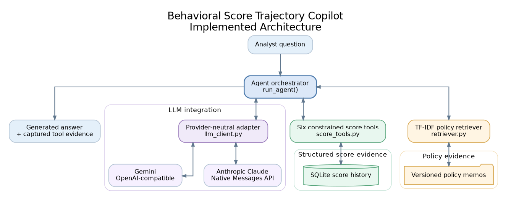
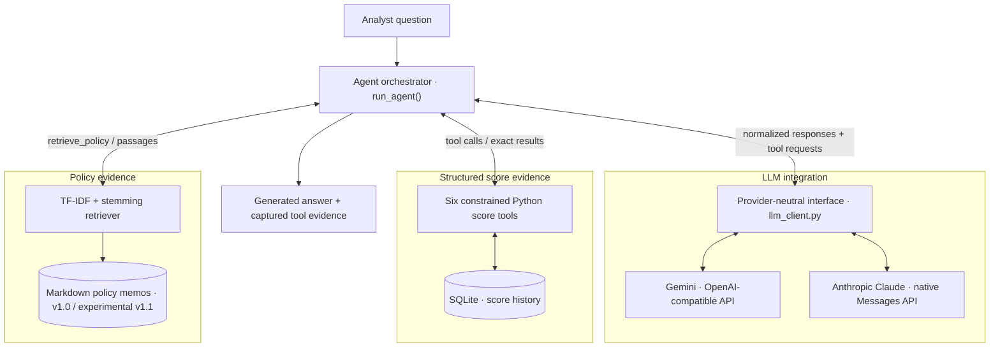
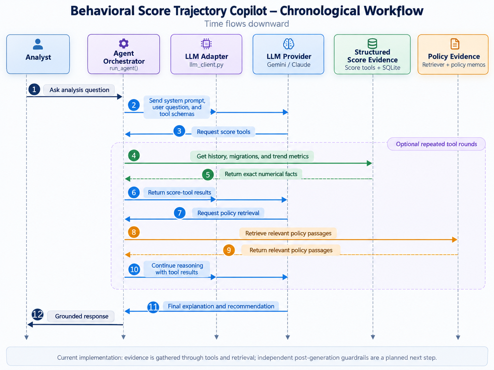
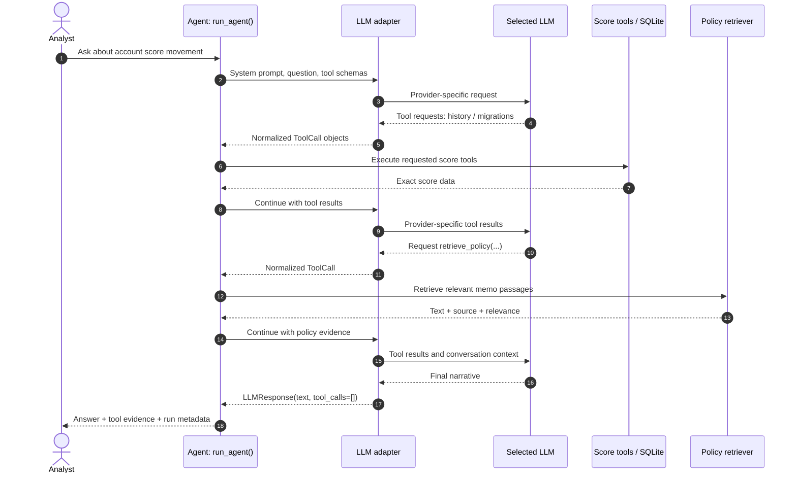

# Architecture

**Behavioral Score Trajectory Copilot** · Implementation snapshot: October 2026

This document describes the **implemented prototype**, not a proposed production lending platform. It complements the [project overview](../README.md) and the [exploratory evaluation](evaluation.md).

## Architecture at a glance

The copilot is a **hybrid tool-calling and retrieval-augmented generation (RAG) agent**. It handles two distinct kinds of evidence:

- **Structured facts:** score histories, migrations, account-level trends, and market averages retrieved by fixed Python/SQLite functions.
- **Policy context:** relevant passages from versioned, project-authored Markdown policy memos retrieved by TF-IDF search.

An LLM chooses which tools to call and composes the answer. Provider-specific message formats are isolated in adapters. The result is **evidence-supported**, not independently certified as correct: post-generation guardrails are a planned component.



<details>
<summary>Mermaid source for the architecture diagram</summary>



</details>

> **Diagram note:** The Gemini and Claude connections show alternative configurations, not two models automatically invoked on each question. The model may request several score and policy tools in one round, or use multiple rounds.

## Runtime components

| Layer | Implementation | Responsibility and output |
| --- | --- | --- |
| Data ingestion | `src/data_loader.py` | Parse the semicolon-delimited sample CSV, convert period dates, and rebuild the SQLite `scores` table. |
| Structured tools | `src/score_tools.py` | Execute predefined, parameterized SQL queries and deterministic Python calculations; return lists/dictionaries rather than generated SQL. |
| Policy retrieval | `src/retriever.py` | Split Markdown memos into heading-aware passages, build a TF-IDF index with Porter stemming, and return ranked passages with source filenames and relevance scores. |
| Orchestration | `src/agent.py` | Construct the system/user messages, expose a combined tool registry, dispatch requested Python functions, return results to the model, and collect evidence. |
| Provider adapters | `src/llm_client.py` | Translate provider-specific tool schemas, responses, and tool-result continuation into a shared `LLMResponse` / `ToolCall` interface. |
| Configuration | `src/config.py` and local `.env` | Select the provider/model/endpoint and read credentials from environment variables. The `.env` file is excluded from version control. |
| Output | `run_agent()` return dictionary | Provide generated `answer`, `completed` flag, captured `tool_evidence`, and `tool_rounds`. |

### Structured-score path

The public sample file, `data/scores_extended.csv`, contains **634 records for 33 accounts across three markets**. `src/data_loader.py` loads it into SQLite. The score tools expose a deliberately restricted surface:

| Tool | Purpose |
| --- | --- |
| `list_accounts(market=None)` | Enumerate known accounts, optionally by market. |
| `get_history(account_id)` | Return an account's ordered monthly scores, bins, dates, and market. |
| `get_latest_score(account_id)` | Return its latest recorded observation. |
| `get_migrations(account_id)` | Return recorded month-to-month bin transitions. |
| `compute_trend(account_id)` | Calculate full-history summary statistics, including net change, migration counts, and score standard deviation. |
| `get_market_average(market, ...)` | Calculate monthly market-level average scores over an optional date range. |

The agent cannot request arbitrary SQL from these tools. Tool parameters are passed to predefined functions; this reduces the surface for hallucinated queries and unbounded database operations.

**Important analytical boundary:** the standard deviation currently exposed by `compute_trend()` describes the **entire available account history**. It is **not** automatically the last-six-period or historical rolling-six-period volatility required for every policy evaluation. A grounded answer must distinguish these calculations instead of treating them as interchangeable.

### Policy-retrieval path

Seven project-authored memos (`POL-001`–`POL-007`) define score bins, early-warning conditions, risk-band actions, market exceptions, data-quality flags, recovery, and escalation. These are demonstration rules, **not an institution's live credit policies**.

The retriever builds its TF-IDF index lazily, tokenizes and stems text, computes cosine similarity, and returns the top matching passages (three by default), including `source`, `heading`, `text`, and `relevance`. It uses document text as evidence; it **does not execute policy rules**.

Module 4.10 compared the original **v1.0** corpus with a separate **experimental v1.1** corpus. The experiment used a policy-version selection mechanism, but the v1.1 experiment directory and archived results have not yet been included in the public repository. The retrieved index is cached in the process, so experimental switches between corpora should use a fresh process to avoid stale indexed content.

## Agent execution sequence

The sequence below is **illustrative**: the exact tools and number of rounds depend on the model response.





In `run_agent(question, llm, max_tool_rounds=8, verbose=True)`:

1. The system prompt tells the model to use numerical tools for account facts and retrieval for policy interpretation, and to distinguish historical triggers, current conditions, and warning-register status.
2. Each tool request is matched to the explicit `ALL_TOOL_DISPATCH` registry. Unknown tools and invalid argument errors return structured error information to the model.
3. Executed calls are recorded in `tool_evidence` with `tool_call_id`, `tool_name`, `arguments`, and `result`. The adapter sends corresponding results back to the same model conversation.
4. The loop repeats until the model returns no tool calls or reaches the eight-round default safety limit. Reaching that limit returns `completed=False` and `answer=None`; it does **not** produce a verified answer.

The trace records what was retrieved and executed. It does not prove that every statement in the generated answer is correct.

## Provider-neutral boundary

`agent.py` operates against a small project-owned protocol rather than importing provider response objects:

```python
@dataclass
class ToolCall:
    id: str
    name: str
    arguments: dict[str, Any]

@dataclass
class LLMResponse:
    text: str
    tool_calls: list[ToolCall]
```

Both adapters implement `chat(messages, tools)` and `continue_with_tool_results(assistant_response, tool_results, tools)`:

- **Gemini:** called through an OpenAI-compatible chat-completions client; provider messages and function calls are normalized by `OpenAICompatibleClient`.
- **Anthropic Claude:** called through the native Messages API; system instructions are handled separately, and native `tool_use` / `tool_result` blocks are normalized and preserved for conversation continuation by `AnthropicClient`.

`get_llm_client(provider)` selects an adapter using `src/config.py`. Adding a provider with another API protocol requires an adapter/configuration path; it should **not** require restructuring the agent's evidence-gathering loop.

One adapter instance retains conversation state for the current run. Concurrent sessions would need separately managed instances; this prototype does not provide a session service or shared state store.

## Evidence, reliability, and scope

**Implemented safeguards:** fixed tool registry, parameterized score queries, evidence collection, instructive system prompt, and bounded tool-calling rounds.

**Not yet implemented:** automated numeric-claim verification, policy-claim validation, deterministic rolling-window eligibility checks, an operational warning register, broad regression tests, and production-grade monitoring. In the current implementation, some argument errors are handled inside the tool loop, but unexpected runtime failures can still interrupt execution. Anthropic's adapter also emits development-oriented debug output.

A particularly important limitation is that three conclusions are **not equivalent**:

1. A warning **was triggered historically**.
2. Its triggering condition **is still ongoing** in the latest month.
3. A warning-register entry **is administratively open or closed**.

The score history can help assess the first two, given explicit policy definitions. The third requires warning-register data not exposed by the current tools. See [evaluation.md](evaluation.md) for the account-103480 case and the policy v1.0/v1.1 experiment.

This architecture supports *analyst-facing explanation and experimental policy interpretation*. It does not approve loans, change credit limits, or automate underwriting decisions.

## Next engineering steps

The planned reliability layer will add deterministic time-window features and evidence-to-claim checks **after** the initial tool/LLM loop. A repeatable evaluation harness will then compare providers and retrieval configurations on a frozen question set, capturing correctness, retrieval relevance, tool efficiency, latency, and cost. These planned components are intentionally **absent** from the implemented-system diagram above.

For the reasoning behind these boundaries and alternatives, see [Engineering Design Decisions](design-decisions.md).
